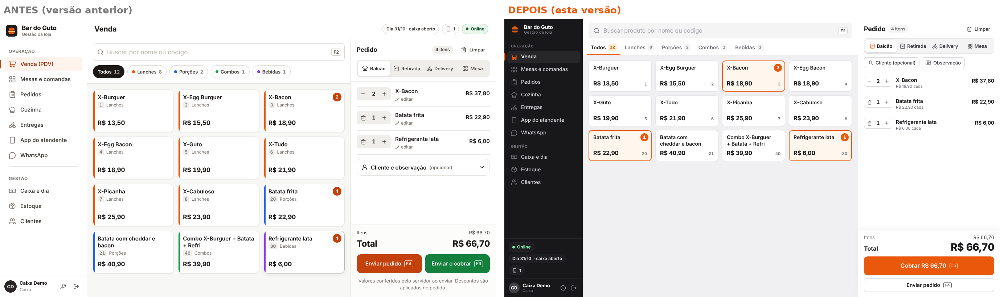
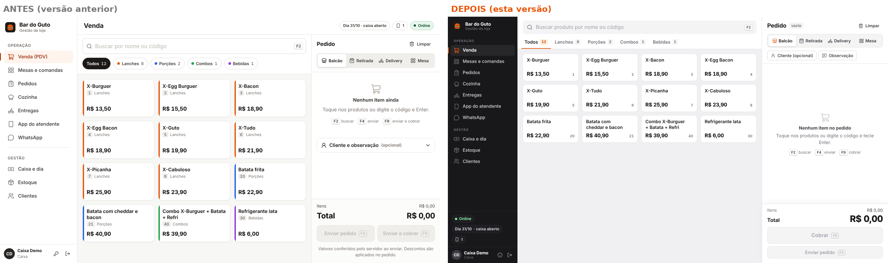
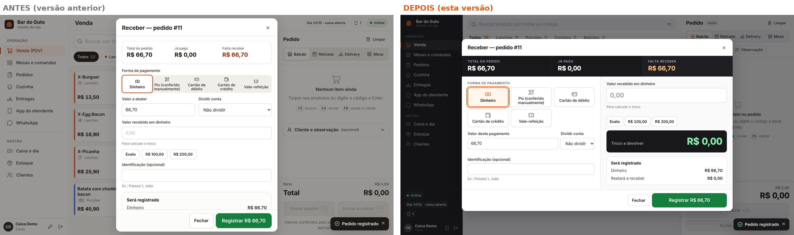
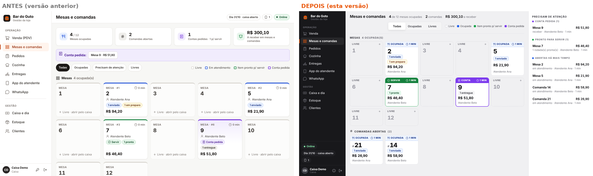
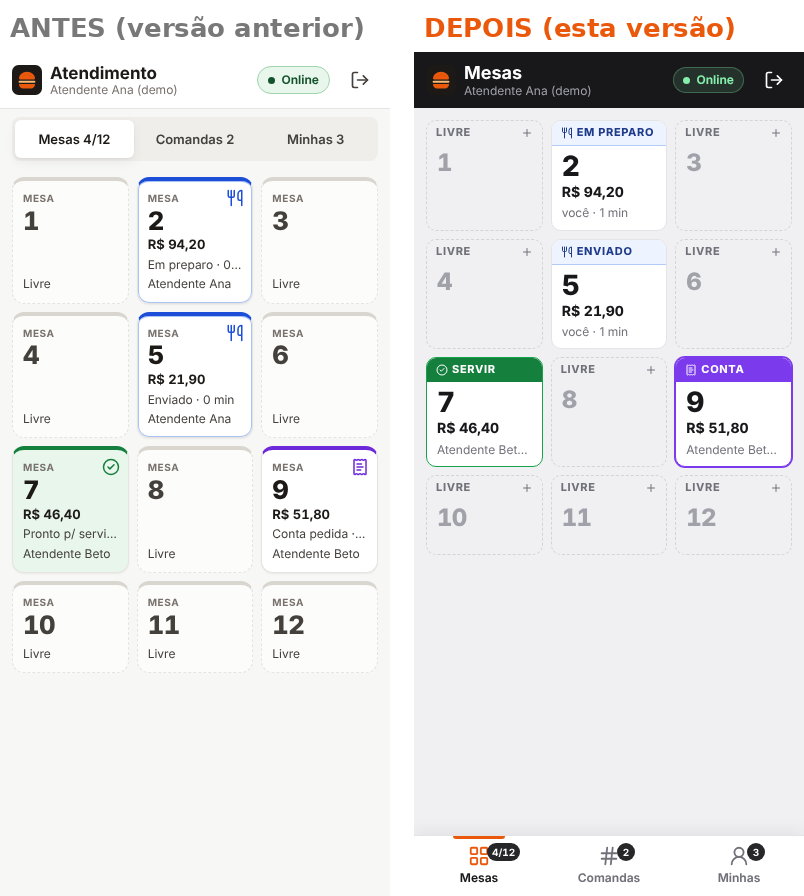
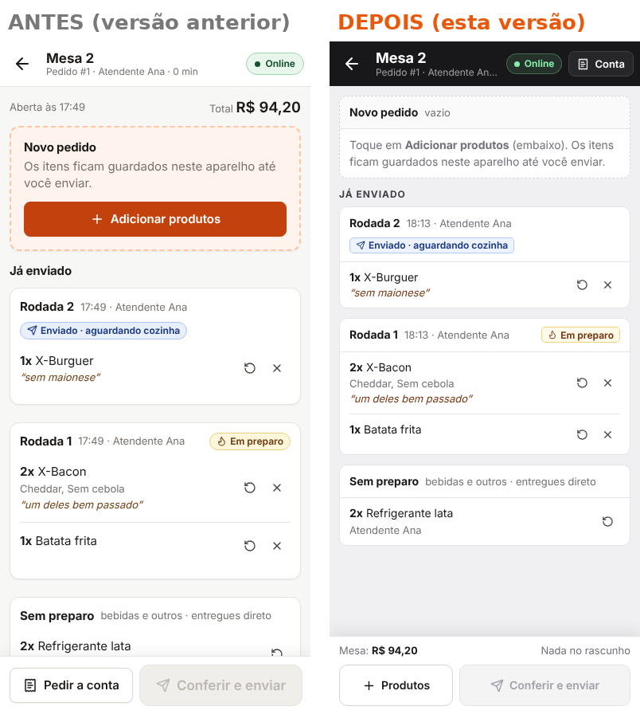
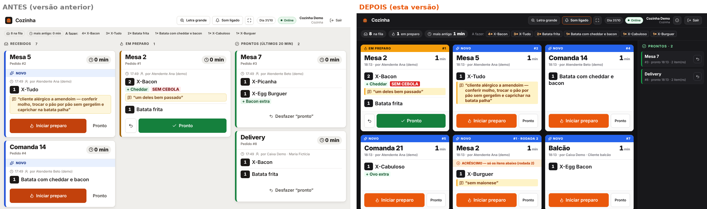
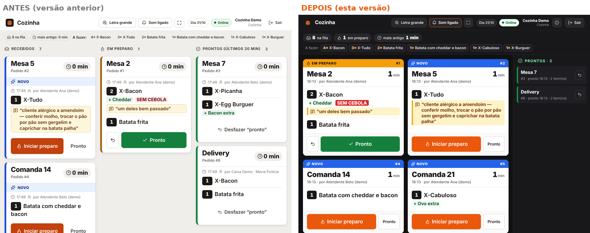

# Reformulação visual — rodada 2

A rodada anterior foi **reprovada pelo dono no aspecto visual** (“praticamente igual”). Esta rodada muda a
composição das telas, não só cores. O que segue é **avaliação técnica**; não é aprovação do dono.

## 1. Conferência da versão (antes de redesenhar)

- A captura enviada pelo dono corresponde exatamente ao build daquele momento (mesmos cartões e carrinho):
  **não era cache** — o problema era o desenho.
- Riscos reais de versão antiga encontrados e corrigidos:
  - o service worker estava em modo “perguntar”: um aparelho podia continuar na versão antiga até alguém
    tocar em “Atualizar”. Agora a versão nova é aplicada **automaticamente ao abrir o app** (primeiros 15 s,
    quando nada está em andamento); depois disso aparece o aviso discreto. O app também procura versão nova a
    cada 10 min e ao voltar para a tela;
  - o servidor listava os arquivos da interface só ao iniciar; agora lê do disco a cada pedido, e
    `index.html`, `sw.js` e `version.json` são entregues com `no-cache` (arquivos com hash: cache longo).
- **Identificação da versão**: barra lateral → ícone (i) **Sobre** (na cozinha/entregador, botão (i) no topo;
  no login, rodapé do painel escuro). Mostra a versão aberta no aparelho, a versão no servidor
  (`/version.json`), se são iguais, o estado do cache e o botão **“Recarregar a versão do servidor”**
  (descarta só a interface guardada; não mexe em dados).
- O identificador é `versão+impressão digital do código` (ex.: `0.2.0+fe9e2945`), calculado a partir do
  código da interface — igual no Linux, no Windows e em cópias baixadas por ZIP (sem Git).
- A demonstração no navegador e o aplicativo real usam **os mesmos componentes e o mesmo CSS**
  (`apps/web/src/demo/main.tsx` importa `App` e `styles.css`); só a API é simulada na demonstração.

## 2. Direção visual

- **Barra lateral grafite** (#18181b), 216 px, itens de 34 px, grupos *Operação* e *Gestão*; item ativo com
  fundo grafite claro, ícone e marcador **laranja**. Status (online, dia/caixa, aparelhos) e usuário ficam
  no rodapé da barra — a área de trabalho não tem mais faixa de pílulas no topo. Abaixo de 1200 px vira
  trilho de ícones (60 px).
- **Área de trabalho clara** (#f0f0f2) com superfícies brancas; bordas finas; sombras só ao passar o mouse
  e em diálogos.
- **Laranja só com intenção**: ação principal (Cobrar, Iniciar preparo, Enviar), seleção e item ativo.
- **Tipografia**: títulos 18–22 px; rótulos de seção em caixa alta 11 px; valores com números tabulares e
  peso 750–800 para comparar rápido (total do pedido 28 px).
- **Densidade**: botões de 40 px (52 px nas ações principais), linhas de tabela de ~38 px, cartões de produto
  de 86 px.

## 3. PDV — duas propostas comparadas com os dados reais

Capturas (1366 × 768, mesmo pedido: 2 X-Bacon, 1 batata, 1 refrigerante):
[A — grade compacta](evidencias/redesign2/propostas/proposta-A-grade-escolhida.png) ·
[B — categorias em coluna + lista](evidencias/redesign2/propostas/proposta-B-lista-descartada.png).

| Critério (1–5) | A: grade compacta + abas | B: categorias em coluna + lista |
|---|---|---|
| Identificar a próxima ação | 5 — “Cobrar” fixo e destacado; selecionados em laranja na grade | 5 — mesmo painel de pedido |
| Legibilidade | 5 — nome e preço juntos no cartão | 4 — preço longe do nome em telas largas |
| Aproveitamento do espaço | 4 — 4–5 colunas, 12 produtos visíveis sem rolar | 3 — coluna de categorias fixa ocupa 172 px; sobra largura vazia nas linhas |
| Velocidade para montar o pedido | 5 por toque/mouse (alvos 150 × 86 px) | 4 por toque (alvos de 46 px de altura); 5 por teclado |
| Consistência e acabamento | 5 — mesmo padrão de cartões do salão e da cozinha | 4 |

**Escolhida: A.** B só seria melhor com centenas de produtos operados só por teclado. A proposta B foi
removida do código depois da comparação (fica a captura como registro).

Composição final do PDV:
- **Catálogo** à esquerda: busca grande no topo (F2), categorias em abas com contagem, grade de cartões com
  nome, preço, código e **quantidade selecionada** (selo e contorno laranja).
- **Pedido** à direita (392 px): título e contador; modalidade (Balcão, Retirada, Delivery, Mesa); cliente,
  endereço e observação como **atalhos compactos** que abrem um diálogo (não ocupam o centro); linhas com
  quantidade − / +, adicionais e observação legíveis, preço unitário e total da linha.
- **Rodapé fixo** com total grande e a ação principal conforme a modalidade: **Cobrar** (balcão/retirada) ou
  **Enviar pedido** (mesa/delivery); a outra ação fica abaixo, secundária.
- **Pagamento** em interface própria: faixa grafite com Total / Já pago / **Falta receber**; formas de
  pagamento em botões grandes; valor deste pagamento e divisão da conta; à direita, dinheiro recebido,
  atalhos de cédulas, **troco grande** e o quadro **“Será registrado”** antes de confirmar.
- Validado em **1366 × 768**: nenhum botão cortado (capturas abaixo).

## 4. Demais perfis (composição própria por tarefa)

- **Mesas e comandas**: barra com números do salão (ocupadas, comandas, a receber), filtro e legenda; mapa de
  mesas com **faixa de estado** no topo de cada mesa (Ocupada azul, Servir verde, Conta roxa, Livre
  tracejada), número grande, valor e atendente; **coluna fixa “Precisam de atenção”** com contas pedidas,
  itens prontos e mesas abertas há mais tempo.
- **Atendente (celular)**: cabeçalho grafite; **navegação inferior** Mesas / Comandas / Minhas ao alcance
  do polegar; mesas no mesmo padrão de faixa do salão; na mesa, **rodapé persistente** com total da mesa e do
  rascunho + “Produtos” e “Conferir e enviar”; “Conta” no cabeçalho; rodadas em blocos.
- **Cozinha**: painel **escuro de produção**, pedidos em **ordem de chegada** em cartões brancos com faixa
  de estado (Novo azul, Na fila grafite, Em preparo âmbar, Atrasado/Cancelado vermelho), local e minutos em
  letra grande, uma ação principal por cartão; **coluna estreita de prontos** com “desfazer”; resumo do que
  falta fazer no topo.
- **Caixa e gestão**: herdam barra grafite, tabelas com cabeçalho compacto, filtros e indicadores; detalhe do
  pedido com cabeçalho grafite.
- **Login**: painel da marca em grafite + formulário claro (no celular, faixa compacta).
- **Cardápio digital**: cabeçalho grafite e placeholders em grafite/laranja, compatíveis com o resto.

## 5. Antes × depois (mesma resolução, mesmos dados, rolagem no topo)

Gerado por `scripts/capturas-comparativo.mjs` após zerar o ambiente de testes e aplicar
`scripts/cenario-teste.mjs`. Imagens completas em [`evidencias/redesign2/`](evidencias/redesign2/).

| Tela | Lado a lado |
|---|---|
| PDV com itens (1366 × 768) |  |
| PDV vazio |  |
| Pagamento |  |
| Mesas (1366 × 768) |  |
| Atendente — mesas (390 × 844) |  |
| Atendente — mesa |  |
| Cozinha (1366 × 768) |  |
| Cozinha (tablet 1024 × 768) |  |

## 6. Funcionamento preservado

Nenhuma regra de servidor mudou. Testes ajustados só onde a **estrutura da tela** mudou (cozinha em fila
única em vez de colunas; total do PDV em outro elemento; espera de 0,8 s antes de tocar um cartão que acabou
de mudar de lugar — é a proteção contra toque errado funcionando). Resultado: ver
[`evidencias/execucao-testes-redesign2.txt`](evidencias/execucao-testes-redesign2.txt).

## 7. Limitações

- Não executado em Windows real (só Linux). O iniciador é o mesmo da rodada anterior.
- A aprovação visual é do dono; aqui há apenas avaliação técnica.
