# Evolução da interface — diagnóstico, decisões e registro

Trabalho executado de forma autônoma. As decisões abaixo são **aprovação técnica** (critérios e testes),
não aprovação do dono nem validação com a equipe da loja.

## 1. Diagnóstico da versão anterior

Capturas (dados fictícios, `scripts/cenario-teste.mjs`) em [`evidencias/redesign/antes/`](evidencias/redesign/antes/).

| Área | Problema concreto observado |
|---|---|
| Identidade | Emojis como sistema de ícones (🧾📋🍽️👨‍🍳🛵…); cada um com estilo e tamanho diferentes, alguns renderizam diferente no Windows. |
| Navegação | Barra lateral escura de 220 px sempre visível, inclusive na **cozinha** (que só tem uma tela) e no tablet, roubando ~20 % da largura. |
| Barra superior | Quatro “pílulas” (dia, caixa, aparelhos, online) sempre visíveis competem com o título. O contador de aparelhos mostrava **“6 sem conexão”** para sessões já encerradas (alarme falso permanente). |
| PDV | Cartões de produto sem hierarquia; código do produto solto no canto; categorias quebram linha no celular; carrinho vazio ocupa a coluna inteira; botões desabilitados viram blocos cinza/verde-claro sem explicação; texto técnico “Prévia… calculado pelo servidor” sempre visível. |
| Mesas | Cartões grandes (só 8 por linha em 1366 px, 2 por linha no celular); **“Comanda 21” estoura o cartão**; “Mesa 10” quebra em duas linhas; cores sem legenda (amarelo/verde/vermelho); selos de andamento com estilos diferentes entre si; mesa livre tem o mesmo peso visual de mesa ocupada. |
| Detalhe do pedido | **ID interno (UUID)** exposto; cinco botões de mesmo peso no rodapé, “Cancelar pedido” vermelho grande ao lado de “Receber”; “Cancelar” ao lado de cada item, fácil de tocar por engano. |
| Cozinha | Botões **“Iniciar preparo” e “Pronto” lado a lado** (toque errado pula etapa); botão “↩” sem rótulo; cabeçalho de coluna quebra (“Prontos (últimos 20 min)”); atraso indicado com animação piscante. |
| Atendente | Grade de mesas em 2 colunas obriga a rolar para ver 12 mesas; “Conferir e enviar” desabilitado amarelo-claro parece ativo; instruções longas no cartão “Novo pedido”. |
| Entregas | Link “mapa” solto; repasse ao motoboy não aparece na fila; colunas vazias com texto em negrito centralizado. |
| Cardápio digital | Sem imagens nem placeholders; lista longa sem destaque de preço; status da loja espremido. |
| Relatórios | Indicadores em caixa-alta com explicações misturadas; “resultado estimado” com valores no meio da largura. |
| Windows | `iniciar-teste.bat` só compilava se não existisse build (código novo não era recompilado); não verificava versão do Node; dava para abrir duas vezes; “zerar” era só uma opção escondida. |

## 2. Plano

1. Design system: tokens (cor, tipografia, espaço, raio, sombra), ícones SVG (`lucide-react`), fonte
   Inter empacotada, componentes padronizados.
2. Layout novo: barra lateral clara com grupos, recolhível em tablet, ausente para perfis de tela única.
3. Redesenho de PDV, Mesas e comandas, App do atendente e Cozinha (prioridade), depois detalhe do
   pedido, entregas, cardápio digital e gestão.
4. Ideias avaliadas por critérios (seção 4).
5. Windows: iniciar/atualizar/zerar previsíveis.
6. Testes completos + capturas “depois” + casos extremos.

## 3. Decisões técnicas

| Decisão | Alternativas consideradas | Motivo |
|---|---|---|
| CSS próprio com **tokens** em `:root` | Tailwind, biblioteca de componentes (MUI/Chakra) | O app já usa classes semânticas; trocar de framework reescreveria tudo e aumentaria o pacote. Tokens dão consistência sem dependência pesada. |
| Ícones **lucide-react** (ISC) | Emojis, SVG desenhados à mão, Material Icons | Traço uniforme, árvore podada (só os ícones usados entram no pacote), funciona offline, sem serviço externo. |
| Fonte **Inter** empacotada (`@fontsource-variable/inter`, OFL) | Fonte do sistema, Google Fonts | Igual no Windows/Android/iOS, números tabulares para dinheiro, sem requisição externa (CSP e modo offline do PWA). |
| Cor de marca **laranja-brasa** `#C2410C` | Amarelo anterior, vermelho | Contraste AA com texto branco (5,2:1), associada a chapa/brasa; distinta das cores semânticas (verde pronto, azul ocupado, violeta conta, vermelho erro/atraso). |
| Estados sempre com **ícone + texto** além de cor | Só cor | Acessibilidade e leitura à distância (cozinha). |

| Iniciador do Windows com **carimbo de build** (hash do código) | Recompilar sempre; comparar datas | Recompilar sempre custa ~1 min a cada início; datas de arquivo mudam ao extrair ZIP. O hash só recompila quando o conteúdo muda e ignora diferença de fim de linha. |
| Dados de teste em `%LOCALAPPDATA%\BarDoGuto\teste` | Dentro da pasta do projeto | Baixar/extrair uma versão nova não apaga os testes; a versão anterior é migrada uma vez. |

## 4. Ideias avaliadas

Critérios: benefício concreto, frequência de uso, risco de erro operacional, manutenção, custo/dependências,
possibilidade de teste. Nenhuma usa IA, serviço pago ou módulo externo.

| Ideia | Benefício · frequência | Risco · manutenção · custo | Decisão | Como foi validada |
|---|---|---|---|---|
| **Busca tolerante** (sem acento, ordem livre, 1 erro por palavra, código exato primeiro) | Acha produto mesmo digitando rápido/errado · várias vezes por pedido | Baixo (só filtra/ordena; nada é lançado sem toque) · função pura no núcleo | **Adotada** (PDV, atendente) | 6 testes unitários + E2E `ui-extras` (“xbacn”, “btaata frita”, código 20 + Enter) |
| **Atalhos de teclado** F2 buscar, F4 enviar, **F9 enviar e cobrar**, código + Enter | Caixa sem mouse · todo pedido de balcão | Baixo; exibidos nos botões (ocultos em telas de toque) | **Adotada** | E2E (Enter por código); F4/F9 usam o mesmo `submit` protegido contra clique duplo |
| **Quantidade no cartão do produto** | Mostra o que já está no pedido sem olhar o carrinho | Nenhum | **Adotada** | E2E (“1 no pedido”) |
| **Bebida/produto sem adicionais com um toque** no app do atendente | Menos passos nas rodadas de bebida · muito frequente | Baixo: vai só para o rascunho, envio continua exigindo conferência | **Adotada** | E2E `waiter-flow` e `ui-extras` |
| **Repetir item** já enviado (“mais uma lata”) | Acréscimo em 1 toque · frequente | Baixo: entra no rascunho com preço de hoje; não envia sozinho | **Adotada** | E2E `ui-extras` (servidor não recebe nada até confirmar) + teste unitário |
| **Repetir último pedido do cliente** (PDV, pelo telefone) | Delivery recorrente · diário | Médio-baixo: usa cardápio/preço atual, itens indisponíveis ficam de fora com aviso, operador confere antes de enviar | **Adotada** | Teste unitário + roteiro no navegador (pedido #8 repetido) |
| **Resumo de gargalos na cozinha** (“A fazer: 3× X-Tudo…”, mais antigo, atrasados) | Cozinheiro vê o que mais pesa · contínuo | Nenhum (só leitura) | **Adotada** | Inspeção visual com 30 pedidos na fila |
| **Aviso discreto de item pronto** para o atendente (faixa + vibração) | Menos idas à cozinha · contínuo | Baixo; vibra só quando aumenta | **Adotada** | Inspeção visual; E2E confirma estados “Pronto”/“Entregue” |
| **Proteção contra toque no cartão que mudou de lugar** (cozinha) | Evita marcar pronto o pedido errado quando a lista se move | Baixo; bloqueia o toque por 0,6 s só no cartão que se moveu e avisa | **Adotada** | E2E de cozinha passam (fluxo normal não é bloqueado). O caso de bloqueio não tem teste automatizado. |
| **Preferências por aparelho** na cozinha (letra grande, som) | Leitura à distância · contínuo | Nenhum (localStorage do aparelho) | **Adotada** | Inspeção visual |
| **Filtros e indicadores** em Mesas (“precisam de atenção”, a receber) | Caixa acha conta pedida/item pronto sem abrir mesas | Nenhum | **Adotada** | Inspeção visual; E2E de mesas |
| **Aviso de nova versão sem travar** (antes `confirm()` bloqueante) | Atualização não interrompe lançamento | Baixo; rascunho fica no aparelho | **Adotada** | Revisão de código (o service worker só dispara em produção) |
| Reordenar o PDV por “mais vendidos do dia” | Menos rolagem | **Alto**: posição dos produtos muda ao longo do dia e quebra a memória muscular (toque errado) | **Descartada** | — |
| Arrastar cartões entre colunas na cozinha | Gestual | **Alto** em tela de toque com mãos ocupadas/molhadas | **Descartada** | — |
| Animação piscante para atraso | Chama atenção | Cansa, não acessível, não diz o porquê | **Removida** (texto “ATRASADO — esperando há N min” + ícone) | Inspeção visual |
| Notificação push do sistema para o atendente | Aviso com o app fechado | Exige serviço de push/VAPID e domínio fixo | **Adiada** (faixa + vibração com o app aberto) | — |
| Modo escuro | Conforto à noite | Dobra a revisão visual; não pedido | **Adiada** | — |

## 5. O que mudou, por tela

- **Base**: tokens em `apps/web/src/styles.css`; ícones `lucide-react`; Inter empacotada; componentes `Alert`,
  `Segmented`, `MoreMenu`, `Button` com ícone/atalho, `Empty` com ícone; foco sem abrir teclado no celular;
  `prefers-reduced-motion` respeitado; novo logotipo e ícones do PWA.
- **Navegação**: barra lateral clara com grupos *Operação* e *Gestão*; trilho de ícones no tablet; perfis de
  uma tela só (cozinha, entregador) sem barra lateral; status compacto (dia/caixa discreto quando está tudo
  aberto, destacado quando não); aparelhos “sem conexão” só para quedas dos últimos 30 min.
- **PDV**: busca com ícone e atalho; categorias com cor e contagem em uma linha rolável; cartões com faixa da
  categoria, código, preço destacado e quantidade no pedido; carrinho com tipo de pedido por ícones, estado
  vazio que ensina os atalhos, ações “Enviar pedido (F4)” e “Enviar e cobrar (F9)” do mesmo tamanho, aviso do
  que falta preencher; tela de confirmação com número grande.
- **Mesas e comandas**: indicadores (ocupadas, comandas, contas pedidas, a receber), filtros, legenda,
  cartões com tipo (mesa x comanda `#`), atendente, tempo, andamento da cozinha e valor; mesa livre com peso
  visual menor; “Comanda 21” não estoura mais.
- **Detalhe do pedido**: resumo Total/Pago/Falta receber no topo; motivo de “Finalizar” bloqueado escrito no
  rodapé; Receber/Entregue/Finalizar em destaque; imprimir, fechar como pendente e **cancelar** em “Mais ações”;
  ID interno recolhido em “Código interno (suporte)”.
- **Pagamento**: formas com ícone; quadro **“Será registrado”** (forma, valor, recebido, troco, quanto restará)
  antes de confirmar.
- **Cozinha**: local (Mesa 5 / Comanda 14 / Delivery) em destaque e número do pedido abaixo; quantidade em
  caixa preta; adicionais em verde, retiradas em vermelho/maiúsculas, observações com ícone; faixas NOVO,
  ACRÉSCIMO, ALTERADO, ATRASADO, CANCELADO com ícone+texto; uma ação principal por cartão (“Iniciar preparo”
  / “Pronto”) e a secundária discreta do lado oposto; letra grande opcional.
- **App do atendente**: cabeçalho claro; abas fixas Mesas/Comandas/Minhas; grade de 3 colunas (12 mesas sem
  rolar num celular de 390 px); faixa “Pronto para servir”; rascunho destacado como “ainda não enviado”;
  seletor de produtos em lista com busca; rodadas mais recentes primeiro; repetir/cancelar como ícones.
- **Entregas**: endereço com ícone, “Cobrar”, **taxa do cliente** e **repasse ao motoboy** separados; prontos
  primeiro.
- **Cardápio digital**: placeholders desenhados por categoria quando não há foto; previsão e total com taxa
  do bairro antes de confirmar; pendências listadas num aviso.
- **Login**: fundo claro com a marca.
- **Gestão** (caixa, pedidos, relatórios, cardápio, estoque, despesas, clientes, ajustes, WhatsApp): herdaram
  tokens, tabelas, abas, selos e estados vazios padronizados; emojis substituídos por ícones.

## 6. Capturas comparativas

Mesmo cenário fictício (`scripts/cenario-teste.mjs`), mesmas telas e tamanhos
(`scripts/capturas.mjs`): [`antes/`](evidencias/redesign/antes/) × [`depois/`](evidencias/redesign/depois/).
Casos extremos (32 produtos com nomes longos, 25 comandas, 30 pedidos na fila, observação longa):
[`extremos/`](evidencias/redesign/extremos/).

| Tela | Antes | Depois |
|---|---|---|
| PDV (1366) | 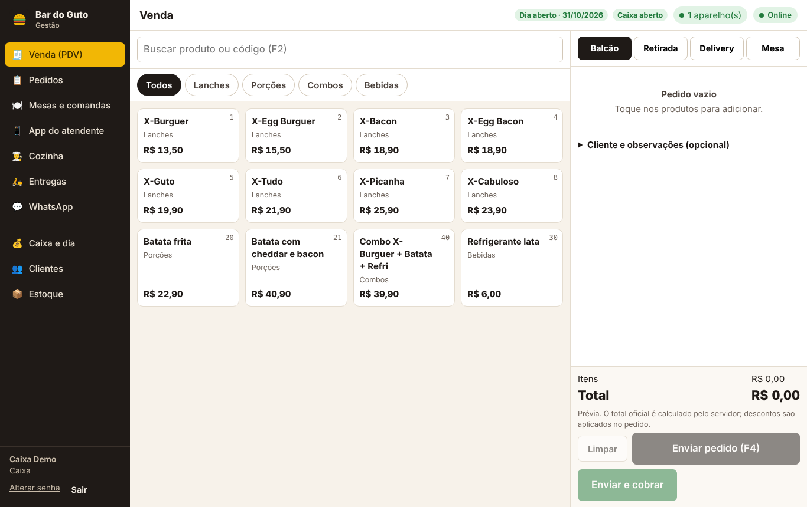 | 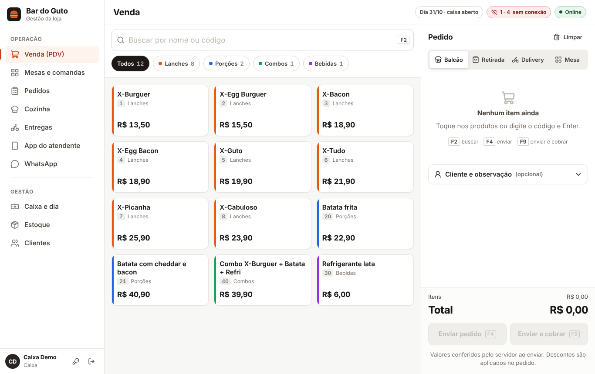 |
| Mesas (1366) | 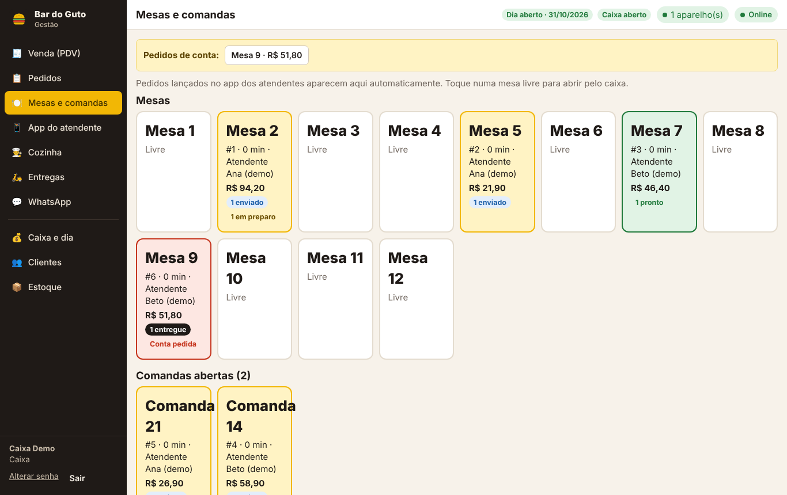 | 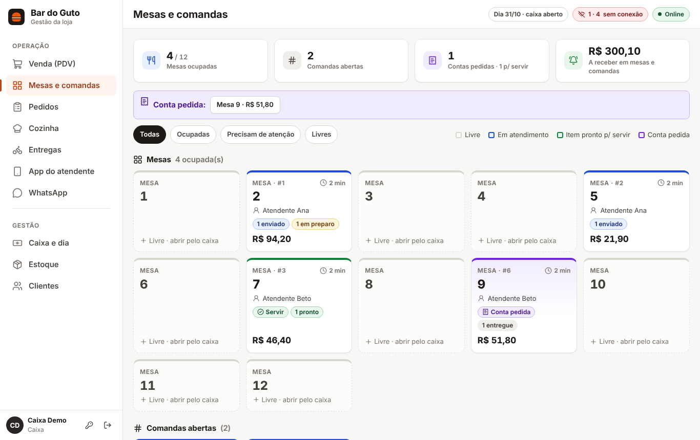 |
| Detalhe da mesa | 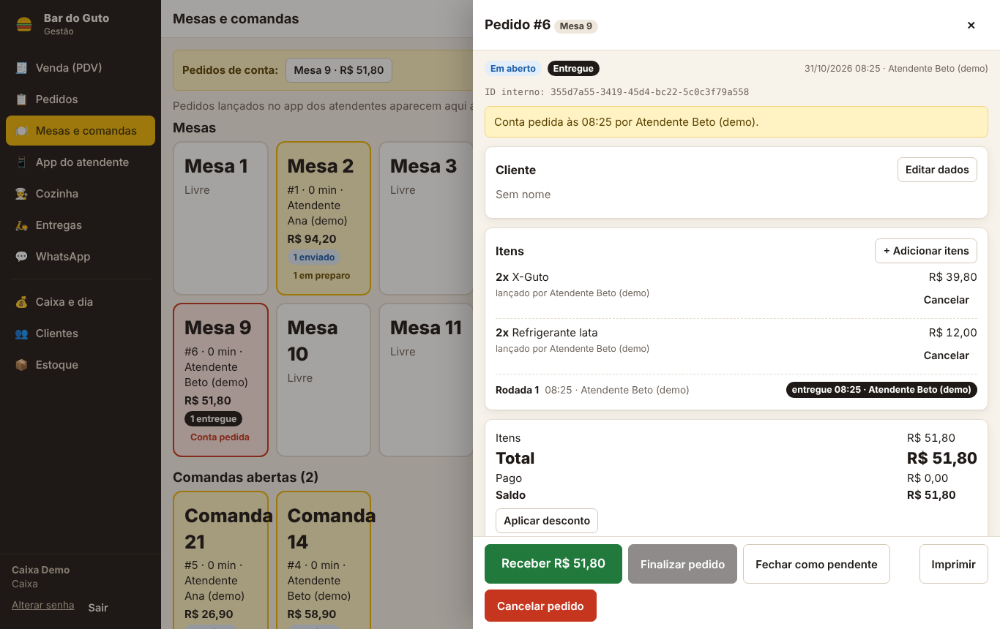 | 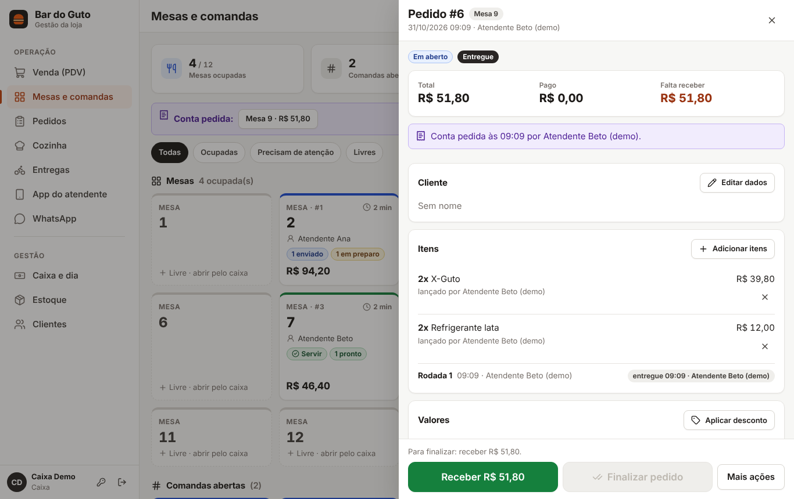 |
| Cozinha (tablet) | 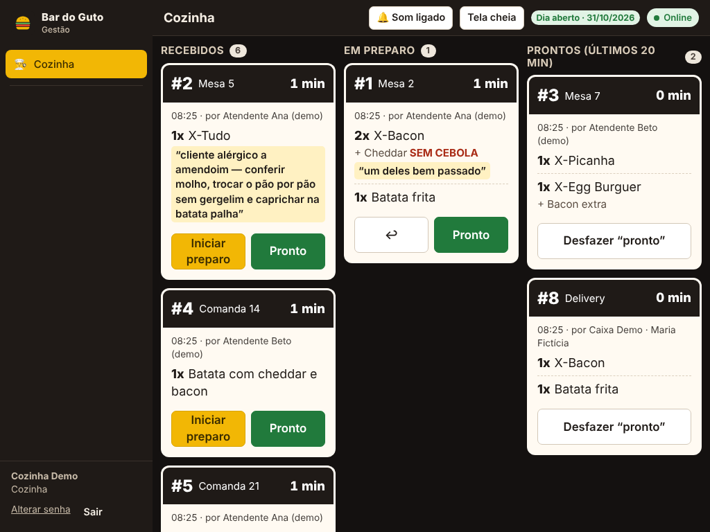 | 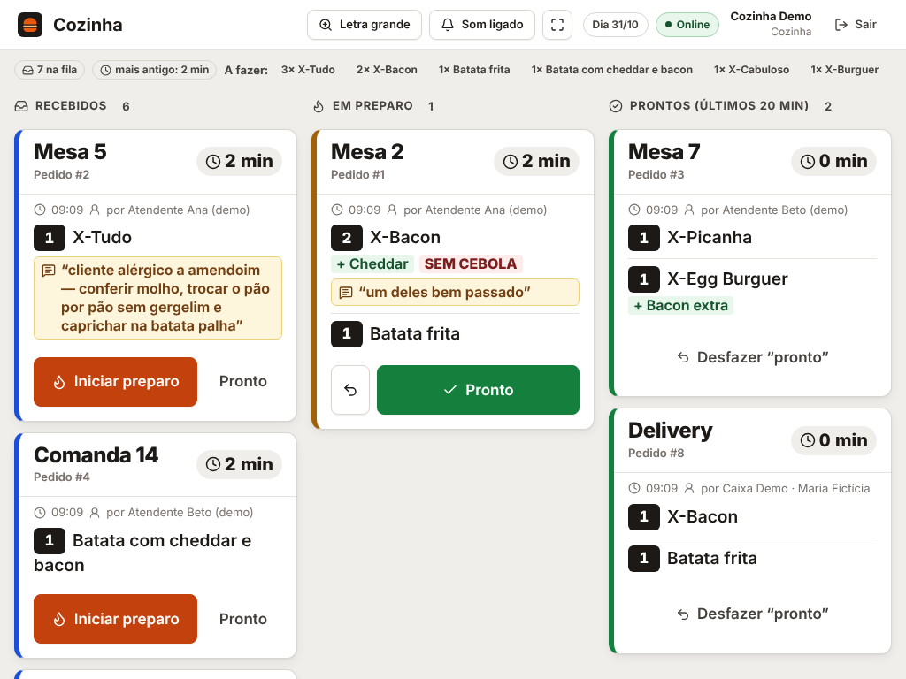 |
| Atendente — início (390) | 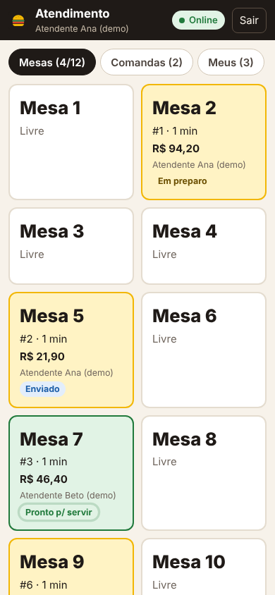 | 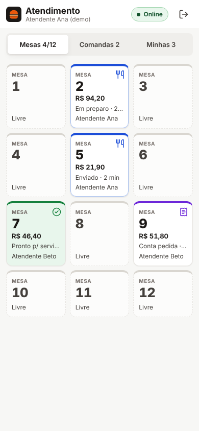 |
| Atendente — mesa | 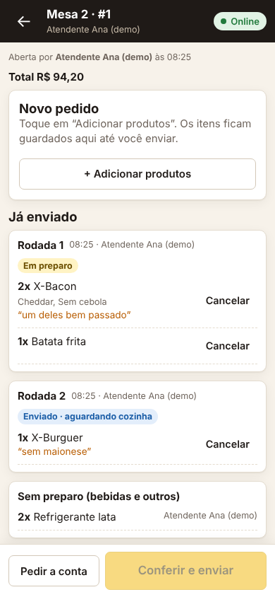 | 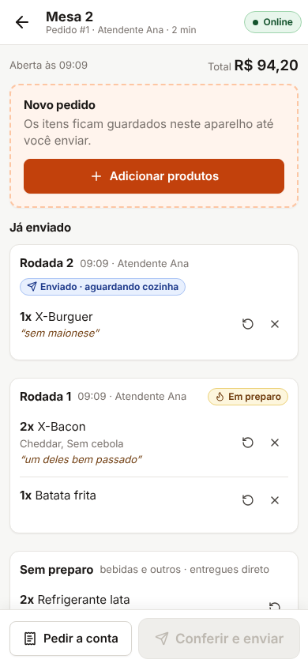 |
| PDV no celular | 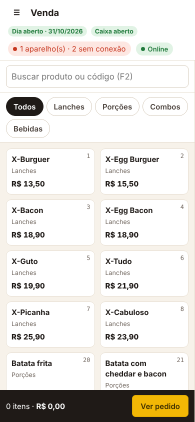 | 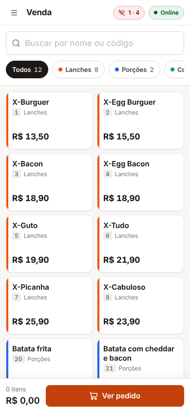 |
| Entregas | 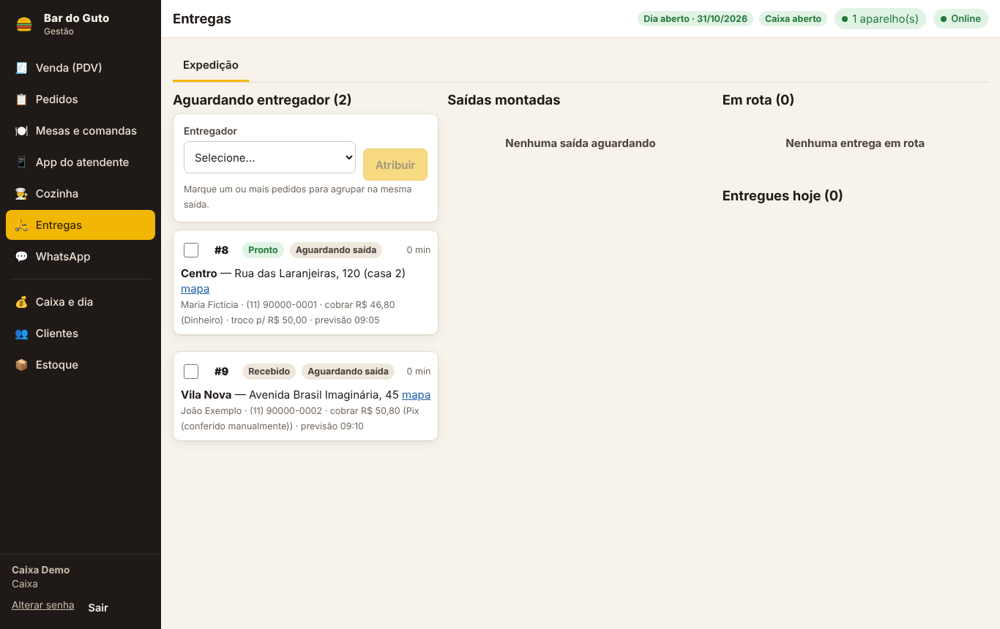 | 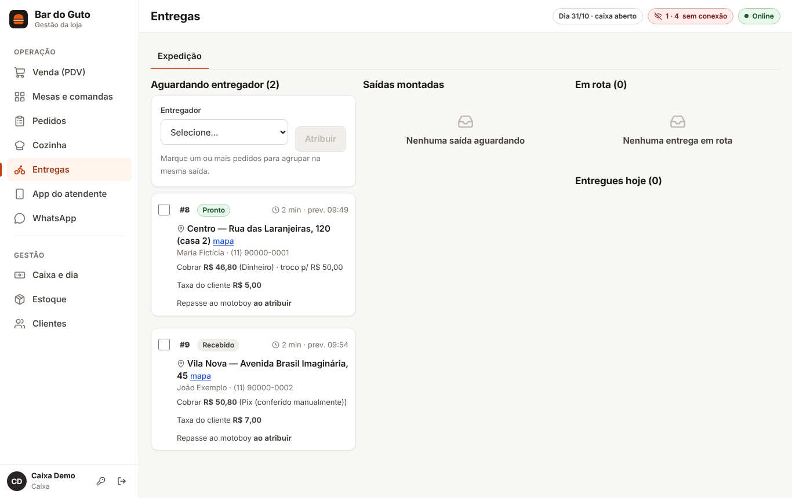 |
| Cardápio digital | 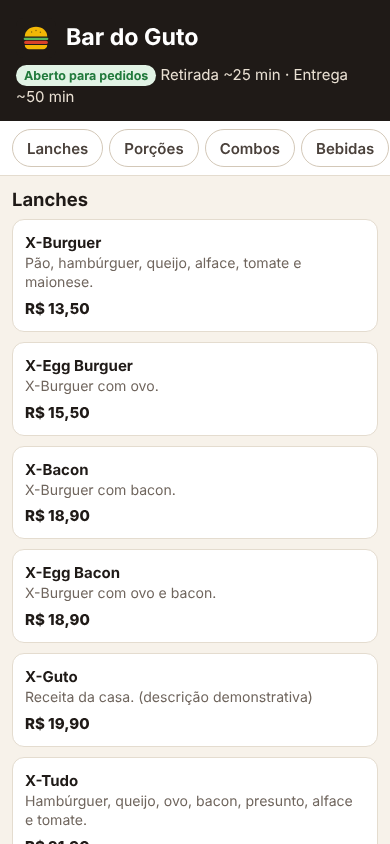 | 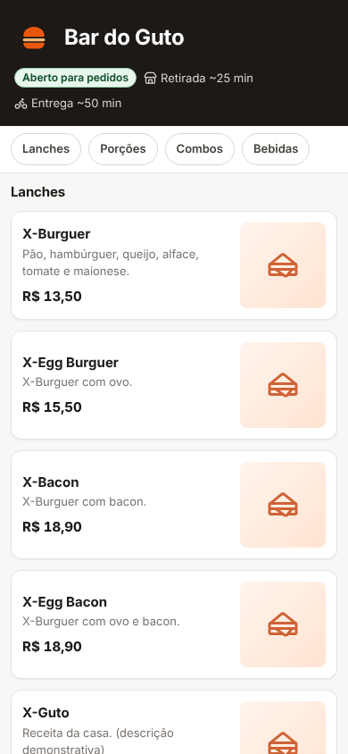 |
| Login | 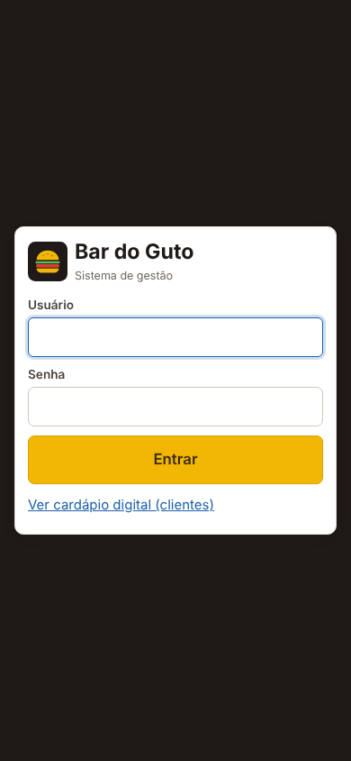 | 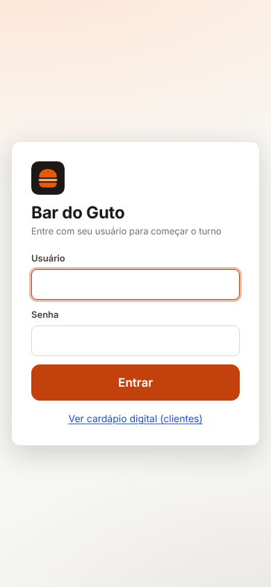 |

## 7. Defeitos encontrados na revisão visual (e corrigidos)

- Classe `.main` do layout aplicada sem querer aos botões da cozinha (ícone acima do texto).
- “Enviar e cobrar” cortado na borda do carrinho; “editar” colado ao nome do item.
- Nome de produto com 2 linhas sobreposto pela linha do código (32 produtos com nomes longos).
- Cabeçalho “COMANDA · 0 MIN” quebrando sob o ícone de estado no celular.
- Título espremido no celular pelos indicadores da barra superior.
- Teclado abrindo sozinho ao abrir diálogos no celular (cobria a lista de produtos).
- Alarme permanente de “aparelhos sem conexão” por sessões encerradas há horas.

## 8. Não validado / limitações

- **Windows**: o iniciador, o zerar e a atualização foram executados **somente em Linux** neste ambiente
  (mesmo script Node; os `.bat` foram revisados, não executados). O download do `cloudflared` pelo próprio
  script não pôde ser testado aqui (download bloqueado neste ambiente).
- A proteção contra toque em cartão que se moveu não tem teste automatizado do bloqueio em si.
- Aprovação técnica pelos critérios acima; **não houve teste com a equipe da loja**. Recomenda-se um turno
  assistido antes de adotar no dia a dia.
- Sem modo escuro; ícone do app mudou (aparelhos com o atalho antigo podem mostrar o ícone antigo até reinstalar).
